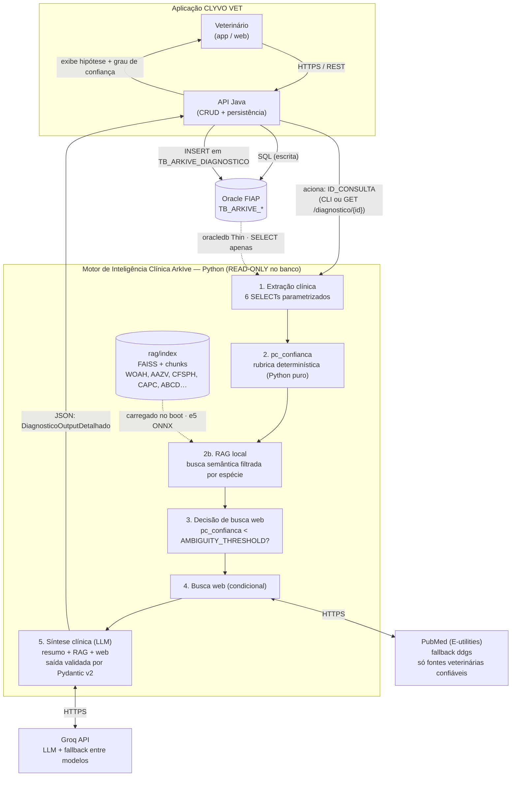

# ArkIve — Motor de Inteligência Clínica Veterinária

> **FIAP Challenge 2026 — 2º Ano ADS | Turmas de Fevereiro**
> Parceria: **Clyvo Vet** · Disciplina: *Disruptive Architectures: IoT, IoB & Generative AI*

---

## Equipe

| Nome | RM |
|------|----|
| Gustavo Crevelari | RM561408 |
| Lucca Gomes | RM561996 |
| Rafaela Ferreira | RM561671 |
| Victor Sabelli | RM566224 |

---

## Repositório

[](https://github.com/2TDSPO-ArkIve/arkive_clinical_engine)

---

## Links

[](https://arkive-clinical-engine.onrender.com)
[](https://mobile-application-sooty.vercel.app/)

| | Link |
|---|---|
| API (Render) | https://arkive-clinical-engine.onrender.com |
| Site (Vercel) | https://mobile-application-sooty.vercel.app/ (crie uma conta para acessar) |

> A API roda no plano gratuito do Render, que hiberna sem uso: a primeira requisição pode levar cerca de 1 minuto. Endpoints em [Endpoints da API](#endpoints-da-api).

---

## Demonstração em Vídeo

[](https://www.youtube.com/watch?v=zWqLgywXfv4)  
[](https://youtu.be/WguMNFGqEAs)

---

## Problema Abordado

A jornada de saúde do pet é **fragmentada e reativa**. Responsáveis e veterinários interagem apenas em momentos pontuais — vacinas, emergências, retornos — sem continuidade inteligente entre as consultas.

Do ponto de vista clínico, isso significa que o veterinário frequentemente:

- Não tem acesso rápido ao histórico consolidado do animal no momento da consulta;
- Precisa cruzar manualmente sintomas, raça, espécie e predisposições genéticas;
- Toma decisões sem suporte de evidências clínicas atualizadas.

**Impacto direto:** agravamento evitável de quadros, baixa adesão a tratamentos e perda de recorrência para as clínicas.

---

## Solução Proposta

O **Motor de Inteligência Clínica Veterinária ArkIve** é um microsserviço Python que, a partir do ID de uma consulta veterinária, extrai os dados clínicos do banco Oracle (histórico do animal, sintomas, bem-estar, predisposições genéticas da raça e diagnósticos anteriores) e aciona um modelo de linguagem (LLM) para gerar uma **hipótese diagnóstica estruturada**, consumida pelo serviço Java que persiste o resultado no banco.

O motor opera em **modo estritamente read-only** no banco e atende qualquer espécie animal — doméstica, silvestre, zoológica ou de produção. Está disponível via CLI (`main.py`) e API REST (`api.py`).

A cada consulta, o veterinário recebe uma hipótese **explicada e com grau de confiança** para revisar e validar. Essa validação entra como contexto da próxima consulta do mesmo animal — é isso que torna a jornada *contínua*.

### Como a solução melhora a jornada

| Para quem | Benefício |
|-----------|-----------|
| **Pet** | Hipótese diagnóstica mais fundamentada, considerando predisposição genética e histórico clínico |
| **Responsável** | Continuidade do cuidado — cada consulta alimenta a inteligência do sistema |
| **Veterinário** | Apoio à decisão clínica em segundos, com raciocínio explicado e grau de confiança |
| **Clínica** | Diferencial competitivo com IA integrada ao prontuário existente |

---

## Componente de Inteligência Artificial

### Um motor híbrido: regras + LLM

A abordagem combina um **motor de regras determinístico** com um **LLM de saída estruturada validada**:

- **Motor de regras (Python puro, sem LLM):**
  - `_calculate_confidence()` — rubrica de pontos fixa sobre os dados reais do Oracle; produz o `pc_confianca` (0–100). Auditável, reproduzível e sem custo.
  - `_decide_web_search()` — usa o **mesmo** `pc_confianca` para decidir se aciona a busca web (`pc_confianca < AMBIGUITY_THRESHOLD`).
  - Match de predisposição × sintomas por palavras-chave catalogadas (`TB_ARKIVE_DOENCA.DS_SINTOMAS`).
- **LLM (Groq API, `ChatGroq.with_structured_output`):** faz a síntese clínica em português sobre o contexto do animal. Saída validada por Pydantic v2 (`DiagnosticoOutputDetalhado`), `temperature=0.10`, com fallback automático entre modelos.
- **RAG local (ONNX + FAISS):** busca semântica numa base curada de 782 fichas veterinárias, filtrada pela espécie, com um modelo de embedding fine-tunado pela equipe (ver [RAG — Base de Conhecimento Local](#rag--base-de-conhecimento-local)).
- **Busca web condicional (PubMed, com fallback `ddgs`):** literatura complementar quando a confiança é baixa (ver [Fluxo de Decisão — Busca Web](#fluxo-de-decisão--busca-web)).
- **Prompt engineering:** system prompt com travas anti-alucinação explícitas (`prompts/diagnostic.py`).

Determinismo onde existe regra clara; IA Generativa onde é preciso julgamento e redação — sempre com validação de schema e o `pc_confianca` calculado fora do modelo.

### Dados clínicos e personalização por animal

A personalização é **por animal**, não por um perfil genérico de espécie/raça. Todos os dados vêm do Oracle da FIAP, apenas com `SELECT`.

| Fonte | Colunas-chave | Uso pela IA |
|---|---|---|
| `TB_ARKIVE_ANIMAL` + `TB_ARKIVE_ESPECIE` + `TB_ARKIVE_RACA` | `NM_ANIMAL`, `DS_SEXO`, `DS_CASTRADO`, `DT_NASCIMENTO`; `NM_ESPECIE`; `NM_RACA`, `TP_PORTE` | perfil do paciente: espécie, raça, porte, sexo, status reprodutivo, idade |
| `TB_ARKIVE_CONSULTA` | `DS_MOTIVO`, `DS_SINTOMAS`, `DS_OBSERVACAO`, `DS_TRANSCRICAO`, `DS_OBS_RESPONSAVEL`, `KG_PESO` | quadro clínico atual; `DS_TRANSCRICAO` é o relato bruto (voz) do veterinário; `DS_OBS_RESPONSAVEL` é a observação do tutor para esta consulta |
| `TB_ARKIVE_RELATO_ANIMAL` + `TB_ARKIVE_RESPONSAVEL` | `DS_RELATO`, `DT_OCORRENCIA`, `DT_CRIACAO`, `ST_ORIGEM_TRANSCRICAO`; `NM_RESPONSAVEL` | histórico de relatos do tutor (texto ou áudio transcrito), com data e autor; percepção do responsável, não diagnóstico |
| `TB_ARKIVE_AVALIACAO_BEM_ESTAR` | `NR_IDADE`, `KG_PESO`, `DS_APETITE`, `DS_ATIVIDADE`, `DS_COMPORTAMENTO` | indicadores sistêmicos ao longo do tempo |
| `TB_ARKIVE_PREDISPOSICAO` + `TB_ARKIVE_DOENCA` | `ID_ESPECIE`, `ID_RACA`; `NM_DOENCA`, `DS_SINTOMAS` | predisposições da espécie (sempre) e da raça exata |
| `TB_ARKIVE_DIAGNOSTICO` (outras consultas) | `DS_DIAGNOSTICO`, `TP_SEVERIDADE`, `PC_CONFIANCA`, `ST_VALIDACAO_VET` | recorrência, progressão de severidade, ceticismo com o não validado |
| `TB_ARKIVE_PRESCRICAO` + `TB_ARKIVE_ADESAO_PRESCRICAO` | `NM_MEDICAMENTO`, `DS_DOSAGEM`, `DT_INICIO`/`DT_FIM`; `ST_TOMOU` | tratamento em curso, falha de resposta, baixa adesão como risco |
| `TB_ARKIVE_PROTOCOLO_PREVENTIVO` + `TB_ARKIVE_EVENTO_PREVENTIVO` | `TP_PROTOCOLO` (vacina, vermífugo, check-up), `ST_STATUS`, `DT_PROXIMO` | cuidado preventivo atrasado como fator de risco |

O `pc_confianca` também é personalizado: é calculado sobre os dados **daquele** animal e decide, para aquele caso, se vale buscar literatura externa.

---

## Tecnologias Utilizadas

| Camada | Tecnologia | Papel no sistema |
|--------|-----------|-----------------|
| Linguagem | Python 3.11+ | Orquestra todas as etapas |
| LLM / IA Generativa | [Groq API](https://console.groq.com) · modelo configurável, com fallback | Gera o raciocínio clínico e o diagnóstico |
| Integração LLM | `langchain-groq` + `langchain-core` · `ChatGroq.with_structured_output()` | Saída JSON validada pelo Pydantic |
| Banco de Dados | Oracle via `oracledb` (modo Thin) | Fonte de dados clínicos — somente leitura |
| Validação de Schema | Pydantic v2 | Valida e tipifica a saída da IA |
| RAG local | `onnxruntime` + `tokenizers` + `faiss-cpu` · modelo `Sabelli/arkive-e5-vet` (e5-small fine-tunado, int8) | Busca semântica na base de fichas veterinárias, sem chamada externa |
| Ingestão da base | `docling` (Colab) | Converte os PDFs das fontes em Markdown estruturado |
| Busca Web | PubMed E-utilities · fallback `ddgs` | Literatura veterinária complementar de fontes confiáveis |
| API REST | FastAPI + Uvicorn | Diagnóstico, health e pipeline ao vivo (ver [Endpoints da API](#endpoints-da-api)) |
| Configuração | `python-dotenv` | Parâmetros e credenciais via `.env` |

---

## Arquitetura do Sistema

1. O **veterinário** usa a aplicação (app/web) para registrar animal, consulta, bem-estar, prescrições e eventos preventivos.
2. A **API Java** faz o CRUD e persiste tudo no **Oracle** (`TB_ARKIVE_*`).
3. Ao concluir uma consulta, a API Java aciona o **Motor ArkIve** por `ID_CONSULTA`, via CLI (`python main.py <id>`) ou REST (`GET /diagnostico/{id_consulta}`).
4. O motor lê o Oracle (6 SELECTs), calcula o `pc_confianca`, consulta o **RAG local**, busca no **PubMed** se a confiança for baixa e chama a **Groq API**.
5. O motor devolve um **JSON estruturado** (`DiagnosticoOutputDetalhado` + `ds_insight_ia`).
6. A **API Java grava** o resultado em `TB_ARKIVE_DIAGNOSTICO`.
7. A aplicação **exibe a hipótese** ao veterinário, que a valida (`ST_VALIDACAO_VET`). Essa validação entra no histórico da próxima consulta.



### Pipeline interno do motor

| Etapa | O que faz |
|---|---|
| 1. Extração | 6 SELECTs parametrizados: animal, consulta, bem-estar, predisposições (espécie + raça; só as `PREDISPOSICAO_LIMIT` mais ligadas ao relato vão ao LLM, com descrição e sintomas cortados em `PREDISPOSICAO_DESC_CHARS` caracteres), últimos `DIAGNOSTIC_HISTORY_LIMIT` diagnósticos, últimas `HISTORICO_CUIDADO_LIMIT` prescrições (com adesão), eventos preventivos e os `RELATO_RESPONSAVEL_LIMIT` relatos do responsável mais recentes (cada um cortado em `RELATO_RESPONSAVEL_CHARS` caracteres; o relato igual à observação da consulta é descartado) |
| 2. Confiança | `_calculate_confidence()` aplica a rubrica (ver [Cálculo de Confiança](#cálculo-de-confiança-pc_confianca)) |
| 2b. RAG | `DS_MOTIVO` + narrativa clínica viram consulta semântica; os `RAG_TOP_K` documentos acima de `RAG_MIN_SCORE` vão ao prompt |
| 3. Decisão | Busca web se `pc_confianca < AMBIGUITY_THRESHOLD` |
| 4. Busca web | PubMed primeiro; `ddgs` só se o PubMed voltar vazio |
| 5. Síntese | Groq recebe resumo clínico + `pc_confianca` pronto + RAG + web e gera `DiagnosticoOutputDetalhado` |

### Estrutura de Arquivos

```
arkive_clinical_engine/
├── .env                            # Variáveis de ambiente (segredos como <API_KEY>)
├── requirements.txt                # Dependências
├── config.py                       # Configuração centralizada + validação fail-fast
├── main.py                         # Ponto de entrada CLI
├── api.py                          # Ponto de entrada API REST (FastAPI)
├── agents/
│   └── clinical_agent.py           # Motor principal (rubrica + RAG + busca web + Groq)
├── database/
│   ├── connection.py               # Conexão Oracle Thin, READ-ONLY
│   └── queries.py                  # 6 SQLs parametrizados + dataclass ClinicalContext
├── prompts/
│   └── diagnostic.py               # System prompt
├── rag/
│   ├── PDFtoMD.ipynb               # Converte os PDFs das fontes em .md (Colab, Docling + OCR)
│   ├── build_index.ipynb           # Gera o índice (Colab): chunking e embeddings
│   ├── finetune_e5.ipynb           # Fine-tuning do e5 (Colab T4), exporta ONNX int8
│   ├── ajuste_rag.ipynb            # Calibração de RAG_MIN_SCORE e RAG_MAX_CHARS
│   ├── retriever.py                # RagRetriever: busca semântica + bloco de contexto
│   ├── eval/                       # avaliar.py, casos.jsonl (108 casos rotulados), pares.jsonl, baseline.json
│   ├── index/                      # faiss.index + chunks.jsonl + manifest.json
│   └── model_cache/                # Modelo de embedding baixado (ignorado no Git)
└── schemas/
    └── diagnostic_detalhado.py     # Pydantic v2: DiagnosticoOutputDetalhado
```

---

## Como Executar (How To)

### Pré-requisitos

- Python 3.11 ou superior
- Acesso ao banco Oracle da FIAP (`oracle.fiap.com.br`)
- Conta gratuita no [Groq Console](https://console.groq.com) para obter a API Key
- Token **Read** do Hugging Face com acesso ao modelo `Sabelli/arkive-e5-vet` (repo privado)

### 1. Clonar o repositório

```bash
git clone https://github.com/2TDSPO-ArkIve/arkive_clinical_engine.git
cd arkive_clinical_engine
```

### 2. Criar e ativar o ambiente virtual

```bash
# Windows
python -m venv venv
venv\Scripts\activate

# Mac / Linux
python -m venv venv
source venv/bin/activate
```

### 3. Instalar as dependências e baixar o modelo do RAG

```bash
pip install -r requirements.txt
python -m rag.retriever --download   # modelo de embedding (~113 MB), exige HF_TOKEN
python -m rag.retriever              # teste com relato de exemplo
```

O índice já vem pronto em `rag/index/`. Se o RAG não carregar, o motor segue funcionando e registra `RAG indisponível` no log. No Render, o Build Command é `pip install -r requirements.txt && python -m rag.retriever --download`.

### 4. Configurar as variáveis de ambiente

Edite o `.env`:

```env
# Banco Oracle FIAP
ORACLE_DSN=oracle.fiap.com.br:1521/ORCL
ORACLE_USER=seu_usuario_fiap
ORACLE_PASSWORD=sua_senha_fiap

# Groq (https://console.groq.com → API Keys)
GROQ_API_KEY=gsk_sua_chave_aqui
GROQ_MODEL_PRIMARY=openai/gpt-oss-120b
GROQ_MODEL_FALLBACKS=qwen/qwen3.8-27b,openai/gpt-oss-20b
GROQ_REASONING_EFFORT=medium   # só nos gpt-oss: low, medium ou high
GROQ_MAX_RETRIES_PER_MODEL=2
GROQ_RETRY_BACKOFF_SECONDS=2

# Hugging Face (modelo do RAG em repo privado)
HF_TOKEN=<token Read do HF>

# Opcionais
LOG_LEVEL=INFO
AMBIGUITY_THRESHOLD=80
DIAGNOSTIC_HISTORY_LIMIT=5
HISTORICO_CUIDADO_LIMIT=5
MAX_TRANSCRICAO_CHARS=6000
PUBMED_ABSTRACT_CHARS=700
PREDISPOSICAO_LIMIT=5
PREDISPOSICAO_DESC_CHARS=400
PREDISPOSICAO_RANK_TIMEOUT_S=10
RELATO_RESPONSAVEL_LIMIT=5
RELATO_RESPONSAVEL_CHARS=600
RAG_TOP_K=3
RAG_MAX_CHARS=4500
RAG_MIN_SCORE=0.45
```

### 5. Executar

```bash
python main.py <ID_CONSULTA>
```

**Alternativa via API REST:**

```bash
uvicorn api:app --reload
# GET http://localhost:8000/diagnostico/1
# GET http://localhost:8000/health      → {"status": "ok", "rag": true}
```

**Pipeline ao vivo:** com a API no ar, abra `http://localhost:8000/pipeline`, digite o ID e acompanhe cada etapa (Oracle, confiança, ranking de predisposições, resumo, RAG, decisão e busca web, prompt, Groq, resposta) com os dados reais que passaram por ela e o log do motor em tempo real. O stream SSE fica em `GET /pipeline/stream/{id}`; `/diagnostico` não muda (detalhes em [Endpoints da API](#endpoints-da-api)). Self-check sem Oracle/Groq: `python test_pipeline_stream.py`.

### 6. Saída esperada

```json
{
  "ds_diagnostico": "Suspeita de Gastroenterite Infecciosa Canina",
  "tp_severidade": "MODERADA",
  "pc_confianca": 55,
  "insight_perfil": "Paciente Rex, canino, macho...",
  "insight_correlacao": "Mais provável: giardíase (fezes moles...); depois parvovirose (...); por último...",
  "insight_predisposicao": "Nenhuma predisposição mapeada localmente; limitação de dado...",
  "insight_limitacoes": "Recomenda-se exame de fezes e hemograma completo...",
  "ds_insight_ia": "Paciente Rex, canino, macho...\n\nMais provável...\n\nNenhuma predisposição...\n\nRecomenda-se...",
  "fontes_rag": [{"fonte": "CAPC", "titulo": "Giardia"}],
  "fontes_pesquisadas": [],
  "tokens": {"entrada": 4810, "saida": 1320, "total": 6130}
}
```

Em caso de erro, o JSON contém o campo `"error"` com a causa.

---

## Endpoints da API

Base em produção: `https://arkive-clinical-engine.onrender.com` (local: `http://localhost:8000`). Por enquanto, a API não tem autenticação, para simplificar a integração com a API Java. O CORS está liberado para qualquer origem, sem cookies.

| Método | Rota | O que faz |
|---|---|---|
| `GET` | `/` | Home: apresentação do motor |
| `GET` | `/health` | Verifica se a API está no ar e se o RAG carregou |
| `GET` | `/diagnostico/{id_consulta}` | Gera a hipótese diagnóstica de uma consulta (JSON) |
| `GET` | `/pipeline` | Página do pipeline ao vivo (HTML) |
| `GET` | `/pipeline/stream/{id_consulta}` | Stream SSE com cada etapa da análise |
| `GET` | `/docs` · `/redoc` · `/openapi.json` | Documentação automática do FastAPI |

### `GET /health`

Liveness. Não acessa o Oracle nem o Groq, porque a configuração já foi validada no boot (config inválida impede a API de subir).

```bash
curl https://arkive-clinical-engine.onrender.com/health
# {"status": "ok", "rag": true}
```

`rag` é `false` quando o índice ou o modelo de embedding não carregou. A análise funciona mesmo assim, só sem o contexto do RAG.

### `GET /diagnostico/{id_consulta}`

Endpoint consumido pela API Java. Roda o pipeline completo para o `ID_CONSULTA`:
1. Oracle;
2. `pc_confianca`;
3. RAG;
4. busca web condicional;
5. Groq.

Devolve o `DiagnosticoOutputDetalhado`, mais `ds_insight_ia` e `tokens` (ver [Saída esperada](#6-saída-esperada) e [Schema de Saída](#schema-de-saída-pydantic-v2)). Leva de alguns segundos a cerca de 1 minuto, conforme a busca web e o modelo Groq.

```bash
curl https://arkive-clinical-engine.onrender.com/diagnostico/1
```

| Status | Quando |
|---|---|
| `200` | Diagnóstico gerado |
| `400` | ID menor ou igual a zero |
| `404` | Consulta não encontrada no Oracle |
| `422` | ID não é um número inteiro |
| `502` | Falha no motor de IA (todos os modelos Groq falharam, chave inválida, cota esgotada) |
| `500` | Erro inesperado |

Os erros vêm no formato padrão do FastAPI: `{"detail": "<causa>"}`.

### `GET /pipeline`

Página HTML para apresentação. Mostra cada etapa do diagnóstico em tempo real: Oracle, confiança, ranking de predisposições, resumo, RAG, decisão e busca web, prompt, Groq e resposta. Cada etapa aparece com os dados reais que passaram por ela, ao lado do log do motor. Com `?id=`, a análise começa sozinha:

```
https://arkive-clinical-engine.onrender.com/pipeline?id=1
```

A rota não aparece no `/docs`. A análise é a mesma de `/diagnostico`, mas o resultado só é exibido e nada é devolvido à API Java.

### `GET /pipeline/stream/{id_consulta}`

Server-Sent Events (`text/event-stream`) usado pela página `/pipeline`. Cada mensagem é uma linha `data:` com JSON:

```json
{"etapa": "confianca", "t_ms": 812, "dados": {"pc_confianca": 70, "limiar": 80}}
```

- `etapa`: nome da etapa. A ordem é:
  1. `inicio`;
  2. `oracle`, `confianca`, `predisposicoes`, `resumo`, `rag`, `decisao_web`, `busca_web`, `prompt`, `groq`, `resultado`, com `log` intercalado (cada linha de log do motor);
  3. `erro`, se houver;
  4. `fim`, sempre.
- `t_ms`: milissegundos desde o início da análise.
- `dados`: conteúdo da etapa. No evento `erro`, `dados` traz `{"tipo", "msg"}`, e `tipo` é `Consulta não encontrada`, `Falha no motor de IA` ou `Erro inesperado`.

```bash
curl -N https://arkive-clinical-engine.onrender.com/pipeline/stream/1
```

ID menor ou igual a zero retorna `400` antes de abrir o stream. Os demais erros chegam dentro do stream, como evento `erro`.

### `GET /docs`, `GET /redoc`, `GET /openapi.json`

Documentação gerada pelo FastAPI: Swagger UI interativo em `/docs`, ReDoc em `/redoc` e o schema OpenAPI em `/openapi.json`.

---

## Fluxo de Decisão — Busca Web

A busca web usa o **mesmo `pc_confianca`** calculado deterministicamente — não existe métrica de "ambiguidade" separada. Se `pc_confianca < AMBIGUITY_THRESHOLD` (padrão 60 no código; o `.env` do projeto usa 80), o motor busca literatura antes da chamada ao LLM:

1. **PubMed (E-utilities):** a busca usa os títulos dos documentos do RAG (ou os termos em inglês do glossário), filtrada pela espécie via MeSH (ex.: `Felidae[mh]`). Sem resultado, repete sem o filtro. Vão ao LLM 3 artigos com o abstract cortado em `PUBMED_ABSTRACT_CHARS` caracteres.
2. **`ddgs` (fallback):** só entra se o PubMed voltar vazio. Um pós-filtro aceita apenas uma lista curada de ~108 domínios veterinários confiáveis — bases indexadas, publishers peer-reviewed, manuais clínicos (Merck/MSD), associações (WSAVA, AVMA), conselhos (CFMV), autoridades sanitárias (WOAH, CDC) e escolas de veterinária. A lista fica em `TRUSTED_VET_DOMAINS` (`agents/clinical_agent.py`).

Se nada confiável for encontrado, o motor segue sem contexto externo (`fontes_pesquisadas: []`).

> **Dica para testes:** `AMBIGUITY_THRESHOLD=101` força a busca web em todas as execuções.

---

## RAG — Base de Conhecimento Local

Diferente da busca web, o RAG roda **em toda consulta com relato clínico**. É local, sem custo de API e independe do `pc_confianca`.

**Base indexada** (`rag/index/`, gerada por `rag/build_index.ipynb`): 782 fichas em inglês, 13.257 trechos.

| Fonte | Conteúdo | Trechos |
|---|---|---|
| WOAH | Manuais terrestre e aquático: doenças de notificação obrigatória, diagnóstico e vacinas | 4.501 |
| WHA | Wildlife Health Australia: fichas de doenças da fauna | 2.121 |
| CFSPH | Fichas de doenças infecciosas e zoonoses (Iowa State) | 1.756 |
| ABCD | Doenças infecciosas felinas | 1.560 |
| AAZV | Fichas de doenças de animais de zoológico e silvestres | 1.499 |
| CAPC | Parasitas de animais de companhia | 865 |
| USGS | Doenças de aves silvestres | 613 |
| ARWH | Australian Registry of Wildlife Health: fauna silvestre | 342 |

**Como a base é gerada** (Colab):

1. `rag/PDFtoMD.ipynb` converte os PDFs de cada fonte em Markdown com Docling. Tabelas viram markdown, e o PDF sem texto extraível é reconvertido com OCR. O frontmatter de cada `.md` (`titulo`, `manual`, `categoria`) vem do caminho `<Manual>/<Categoria>/`, e a `fonte` vem da variável `FONTE` no topo do notebook. A `categoria` é o que o filtro de espécie usa.
2. `rag/build_index.ipynb` limpa seções sem conteúdo clínico (referências, vacinas, tabelas numéricas), fatia os textos, gera os embeddings e grava o índice FAISS. É incremental: só os arquivos novos ou alterados são vetorizados.

**Como a busca funciona** (`rag/retriever.py`):

1. A consulta é `DS_MOTIVO` + narrativa clínica, fatiada em janelas e expandida com um glossário PT→EN (a base está em inglês).
2. Embedding com `Sabelli/arkive-e5-vet` e busca por similaridade de cosseno no FAISS. O modelo é o `multilingual-e5-small` fine-tunado pela equipe em relatos sintéticos PT → fichas EN (`rag/finetune_e5.ipynb`), quantizado em int8. O tokenizer é podado no download para caber nos 512 MB do Render, com tokenização idêntica à original.
3. Resultados filtrados pela espécie do animal. Fichas multiespécie sempre entram, com uma pequena penalidade de score para não lotar o top-k.
4. Trechos agrupados por documento. Documentos abaixo de `RAG_MIN_SCORE` são descartados; os `RAG_TOP_K` melhores vão ao prompt, limitados a `RAG_MAX_CHARS` caracteres.
5. O system prompt avisa que relevância é similaridade de texto, não probabilidade da doença: o LLM só usa um documento se sinais clínicos e epidemiologia forem compatíveis. Os documentos enviados voltam em `fontes_rag`.

**Resultado do fine-tuning** no conjunto rotulado (`rag/eval/casos.jsonl`, 108 casos):

| Métrica | e5 genérico | fine-tunado int8 |
|---|---|---|
| recall@3 | 0.376 | 0.634 |
| MRR@10 | 0.327 | 0.513 |
| ruído@3 | 0.330 | 0.093 |

O corte `RAG_MIN_SCORE=0.45` foi escolhido em `rag/ajuste_rag.ipynb` como o menor corte com ruído@3 ≤ 0.15 (recall@3 após o corte 0.247, ruído@3 0.142). Para medir de novo: `python -m rag.eval.avaliar`.

> **Limite conhecido:** a base cobre doenças infecciosas e parasitárias; quadros como corpo estranho ou doença renal não têm ficha compatível. Perto do corte, ruído e documento relevante ainda se sobrepõem — a trava principal contra uso indevido é o prompt.

Falha no RAG (índice ausente, modelo não baixado, erro na busca) **não derruba a análise**: o motor registra o aviso e segue com Oracle + web.

---

## Cálculo de Confiança (pc_confianca)

O grau de confiança é calculado **deterministicamente em Python** sobre os dados reais do Oracle, antes da chamada ao LLM. O modelo recebe o valor pronto e nunca o recalcula.

A rubrica de sintomas avalia a **narrativa clínica**: `DS_TRANSCRICAO` (relato bruto) concatenado a `DS_SINTOMAS`, apenas em memória — nada é gravado de volta.

| Critério | Pontuação |
|----------|-----------|
| BASE (sempre) | +30 pts |
| Narrativa clínica específica e detalhada (> 3 características) | +25 pts |
| Narrativa clínica moderadamente descritiva (1–3 características) | +10 pts |
| Predisposição genética diretamente relacionada aos sintomas (nome da doença ou palavras-chave `DS_SINTOMAS`) | +20 pts |
| Predisposição genética presente mas indiretamente relacionada | +10 pts |
| Avaliação de bem-estar completa e coerente | +10 pts |
| Peso registrado e compatível | +5 pts |
| Dados clínicos relevantes ausentes (peso, idade ou bem-estar) | -10 pts |
| Narrativa clínica vaga ou genérica demais | -15 pts |

> **Predisposição racial ≠ evidência principal.** O prompt só permite tratar uma predisposição como diferencial prioritário quando há sinal clínico compatível na narrativa. Sem isso, ela entra apenas como fator de risco em `insight_predisposicao`.

> **Medicações e cuidado preventivo não entram na rubrica.** Eles alimentam o raciocínio do LLM, mas não alteram o `pc_confianca`, que permanece estável e auditável.

---

## Modelos Groq — Fallback e Retry

O motor tenta os modelos na ordem `GROQ_MODEL_PRIMARY` → `GROQ_MODEL_FALLBACKS`, recomeçando pelo primário a cada execução. Erros de cota ou indisponibilidade (HTTP 429, modelo descontinuado) pulam direto para o próximo modelo; erros transitórios (timeout, conexão, 5xx) são retentados no mesmo modelo.

| Variável | Padrão | Papel |
|---|---|---|
| `GROQ_MODEL_PRIMARY` | `openai/gpt-oss-120b` | Modelo tentado primeiro |
| `GROQ_MODEL_FALLBACKS` | `qwen/qwen3.8-27b,openai/gpt-oss-20b` | Modelos seguintes, em ordem |
| `GROQ_REASONING_EFFORT` | `low` (`.env`: `medium`) | Esforço de raciocínio dos gpt-oss; ignorado nos outros modelos |
| `GROQ_MAX_RETRIES_PER_MODEL` | `2` | Tentativas no mesmo modelo para erro transitório |
| `GROQ_RETRY_BACKOFF_SECONDS` | `2` | Espera entre tentativas, crescente (2s, 4s, ...) |

### Custo por análise

Cada análise faz uma chamada ao LLM com cerca de **6 mil tokens** (system prompt, resumo clínico, bloco RAG e resposta, com raciocínio `medium`). O consumo real volta no campo `tokens` do JSON. No plano gratuito, o `openai/gpt-oss-120b` tem 8 mil tokens por minuto e 200 mil por dia — cerca de **1 análise por minuto e 30 por dia**; acima disso, o fallback troca de modelo. Cada 1.000 caracteres a mais em `RAG_MAX_CHARS` somam cerca de 250 tokens.

---

## Schema de Saída (Pydantic v2)

`DiagnosticoOutputDetalhado`, persistido pelo serviço Java em `TB_ARKIVE_DIAGNOSTICO`:

| Campo | Tipo | Descrição |
|-------|------|-----------|
| `ds_diagnostico` | `str` (5–500 chars) | Título conciso da hipótese diagnóstica |
| `tp_severidade` | `Literal["AUSENTE", "LEVE", "MODERADA", "GRAVE"]` | Classificação de severidade; `AUSENTE` quando o animal não demonstra alteração (ex.: check-up de rotina) |
| `insight_perfil` | `str` (mín. 20 chars) | Perfil do paciente e apresentação clínica |
| `insight_correlacao` | `str` (mín. 20 chars) | Correlação entre sintomas, bem-estar, histórico e hipótese |
| `insight_predisposicao` | `str` (mín. 20 chars) | Papel das predisposições genéticas no raciocínio |
| `insight_limitacoes` | `str` (mín. 20 chars) | Limitações do diagnóstico e exames complementares sugeridos |
| `pc_confianca` | `int` (0–100) | Grau de certeza calculado deterministicamente em Python |
| `fontes_rag` | `list[{fonte, titulo}]` | Documentos do RAG enviados ao LLM (adicionado pelo sistema) |
| `fontes_pesquisadas` | `list[str]` | URLs consultadas (vazia se a busca web não foi acionada) |

O payload também inclui `ds_insight_ia`, composição dos 4 campos de insight para a coluna única `DS_INSIGHT_IA` (CLOB), e `tokens` (`entrada`, `saida`, `total`), que não é persistido.

---

## Garantias de Segurança (READ-ONLY)

O microsserviço garante a imutabilidade do banco em três camadas:

1. **Privilégios DB:** o usuário Oracle deve ter apenas `GRANT SELECT` nas tabelas ArkIve;
2. **`autocommit = False`:** configurado explicitamente na conexão;
3. **`rollback()` no finally:** desfaz qualquer transação pendente antes de fechar a conexão.

Nenhum `INSERT`, `UPDATE`, `DELETE` ou `MERGE` existe no código do motor.

Texto livre do tutor (`TB_ARKIVE_RELATO_ANIMAL`, `DS_OBS_RESPONSAVEL`) vai ao LLM entre os marcadores `<<<RELATO>>>` e `<<<FIM_RELATO>>>`. O motor tira esses marcadores de dentro do texto e junta o relato numa linha. O system prompt manda tratar esse conteúdo como dado e ignorar qualquer instrução escrita nele.

---

## Solução de Problemas Comuns

| Erro | Causa | Solução |
|------|-------|---------|
| `ORA-12505` | SID não reconhecido | Usar o DSN no formato longo: `(DESCRIPTION=(ADDRESS=...)(CONNECT_DATA=(SID=ORCL)))` |
| `ORA-01017` | Usuário/senha incorretos | Verificar `ORACLE_USER` e `ORACLE_PASSWORD` no `.env` |
| `429 quota exceeded` | Cota de um modelo atingida | O sistema troca para o próximo modelo; se todos falharem, aguardar o reset |
| `Erro de configuração` | Variável ausente ou malformada no `.env` | A mensagem lista exatamente o que falhou |
| `Nenhuma consulta encontrada` | ID inexistente | Verificar o ID em `TB_ARKIVE_CONSULTA` |
| `RAG indisponível (...)` | Índice ausente, modelo não baixado ou `faiss` bloqueado pelo Smart App Control do Windows | Rodar `python -m rag.retriever --download`; no Windows bloqueado, testar no Linux/WSL ou no Render |
| `ddgs sem resultado` / `Ratelimit` | PubMed vazio e DuckDuckGo bloqueando o IP (comum em datacenter) | O motor segue sem contexto web; o RAG continua valendo |

---

## Licença

Projeto acadêmico desenvolvido para o Challenge FIAP 2026 em parceria com a Clyvo Vet.
Uso restrito ao contexto educacional.
